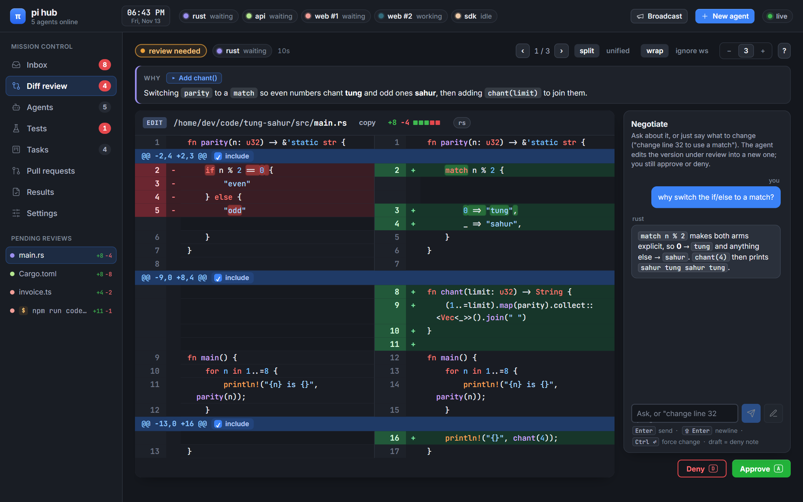
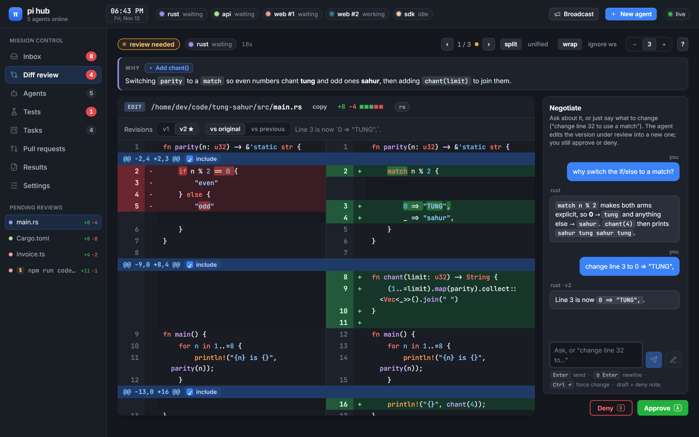
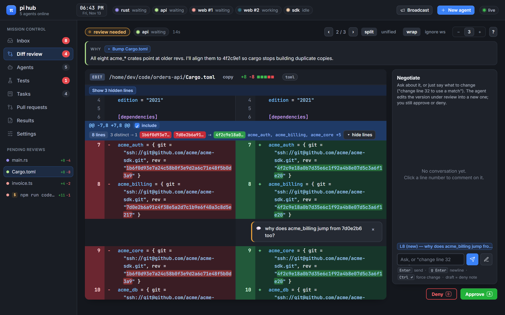
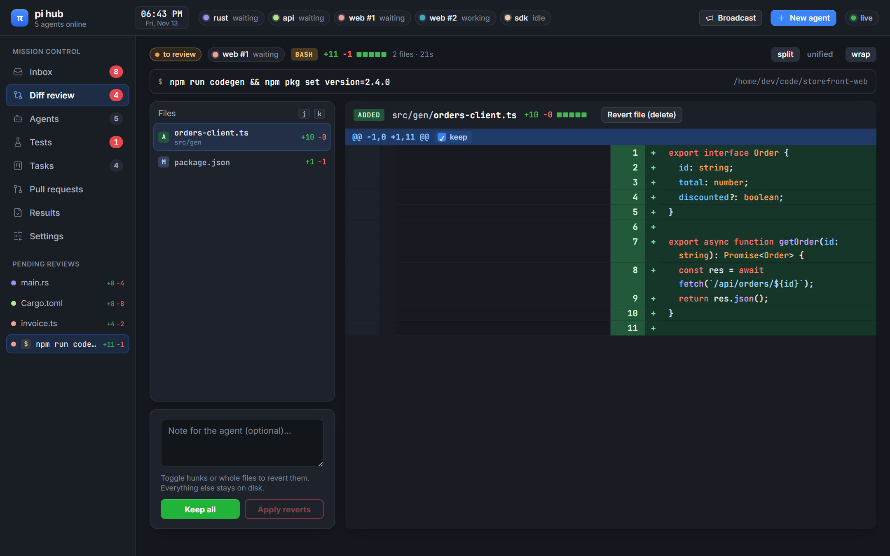
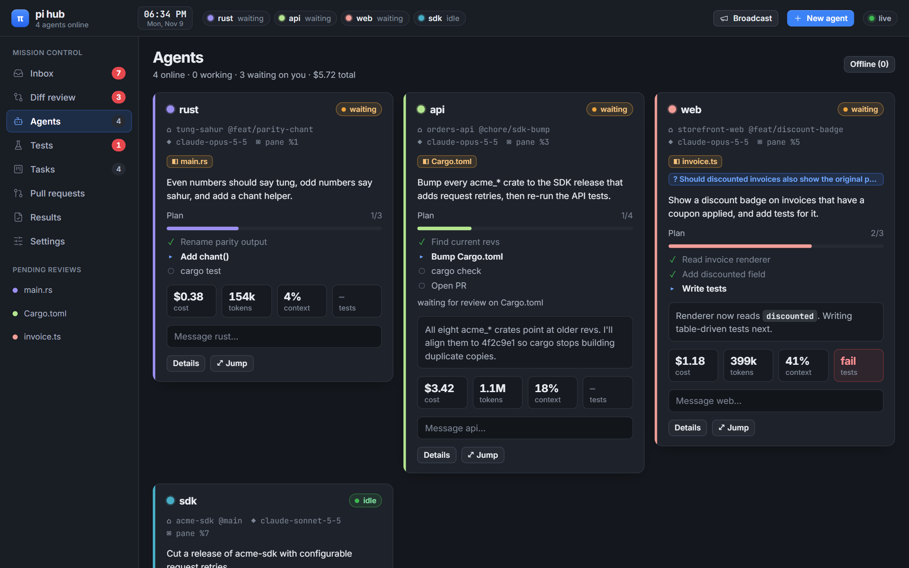
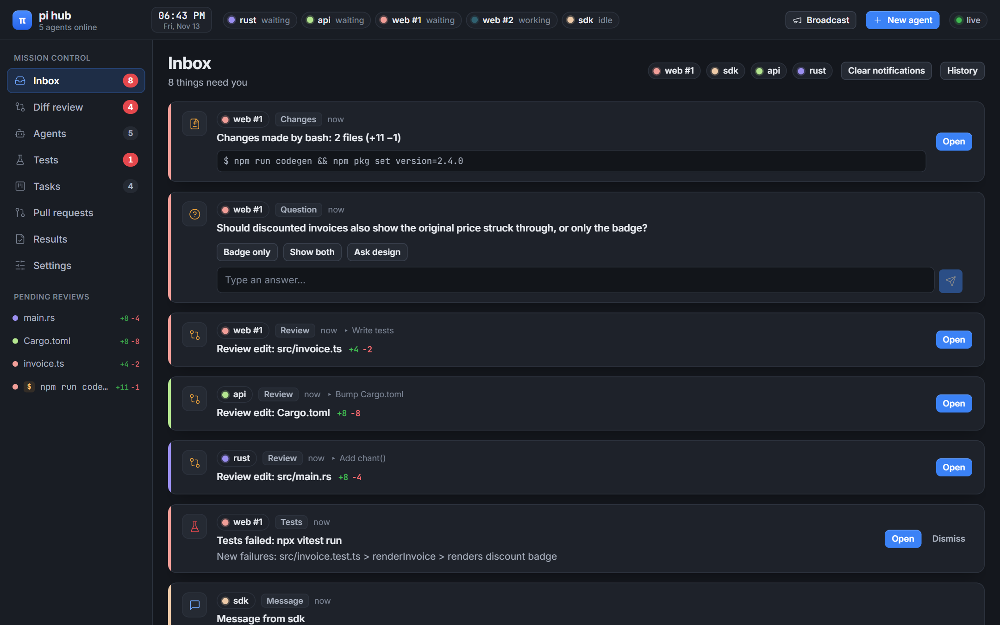
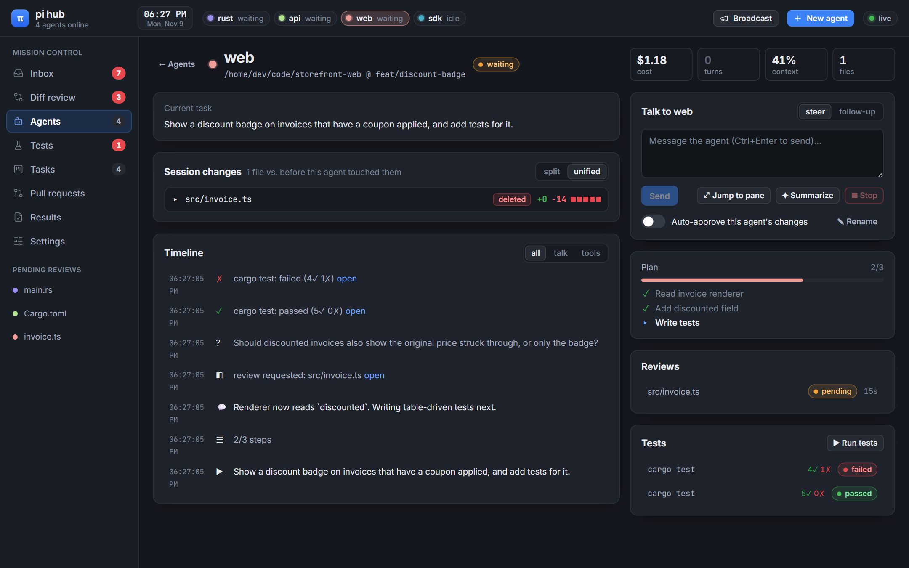
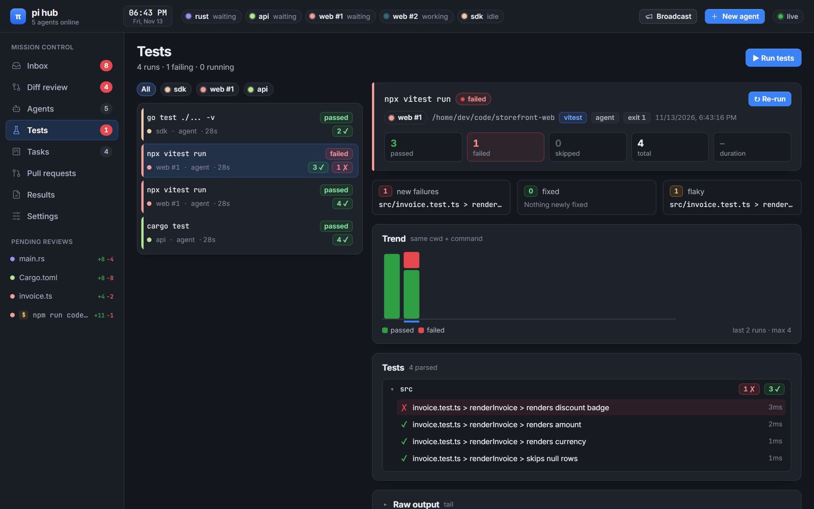
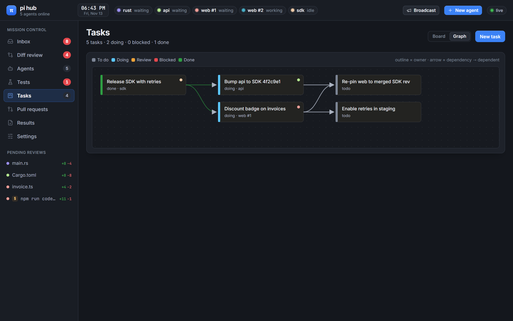
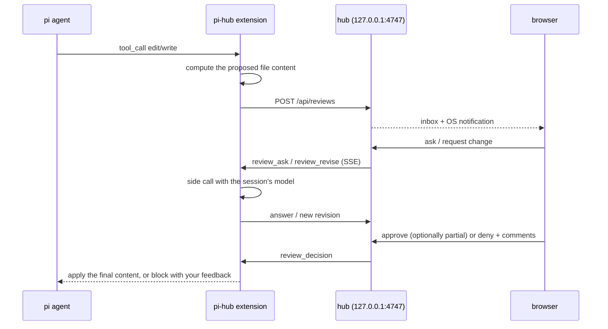

# pi hub

**Mission control for [pi](https://github.com/badlogic/pi-mono) coding agents.** A pi extension plus a tiny local hub that every pi session connects to. Every file change your agents want to make waits in a diff reviewer until you approve it, and one dashboard shows what every agent is doing: questions, progress, tests, tasks, pull requests and results.



## Why

Running several pi agents in tmux panes means constant context switching: which pane is waiting on me, what did that agent just change, did its tests pass? pi hub turns that into one place:

- **Nothing touches disk without you.** `edit` and `write` calls are held until you approve them in the browser. You can approve only some hunks, comment on lines, ask the agent why, or ask it to revise the change in place.
- **One inbox.** Reviews, `ask_user` questions, agent messages, failing tests, PR/CI changes, file conflicts between agents and finished runs, with native notifications on macOS, Windows and Linux.
- **Every agent at a glance.** Each session gets its own color, a live card, a timeline, plan progress, cost, tokens and context usage.
- **Agents can coordinate.** They can see each other, message each other or you, and share a task board with dependencies.

## Features

### Diff review gate

| | |
| --- | --- |
|  | **Talk to the change before approving it.** Ask a question and the agent answers with its own model and context. Or just say what to change ("change line 32 to use a match", "rename chant to sing") and the agent rewrites the version under review into v2, v3… without approving or denying anything. Line numbers match the right side of the diff. Compare any version against the original or the previous one, then decide. |

- Split and unified views, word-level highlights, syntax colors, wrap, ignore-whitespace and context controls.
- **Partial approval.** Untick individual hunks; the file keeps the original text for those.
- **Line comments.** Click a line number. Comments are sent with your question, change request or denial.
- **Smart collapse.** Hunks that only swap hashes or versions (lockfiles, git revs) fold into one `8 lines · 3 distinct → 1` row:

  
- **Deny with feedback.** Your draft and line comments go straight back to the agent as the reason.
- **Trust.** Auto-approve a whole session (`/hub-trust auto`) or files matching a glob (Settings). Auto-approved changes are still logged.
- **Conflicts.** You get a warning when two agents touch the same file. If a file changes on disk while its review is open, approving writes nothing and the agent is told to re-read it.
- **The agent hears back.** Your comments, line comments and any hunks you excluded or edited are added to the tool result the agent sees, so its picture of the code matches what's on disk.
- **Intent next to the diff.** Each review shows what the agent said it was doing when it proposed the change, plus +/− counts in the queue and inbox.

### Changesets: bash writes and per-turn review

The gate catches `edit` and `write`. Everything else is caught by git snapshots:

- **Bash writes.** Before and after every `bash` call that isn't obviously read-only, the extension snapshots the working tree into a temporary git index, so your real index is never touched. Files the command created, changed or deleted show up as a **changeset** you can keep, or revert per file or per hunk. Reverts are only written if the file still matches what the command left, and the agent is told what you reverted.
- **Checkpoint mode.** Approving every edit doesn't scale past a couple of agents. Use `/hub-mode checkpoint` or the "Review: per turn" switch to let an agent edit freely; when its turn ends, everything it changed arrives as one multi-file changeset.



Changesets need the agent's working directory to be a git repository.

### Multi-agent coordination

- **Spawn in a worktree.** "New agent" can create a `git worktree` on a fresh `agent/<name>` branch, then pick the model, review mode and trust, and link a task. "Spawn agent for this task" does it from the task editor. Spawn settings are applied by the hub when the new session registers, so an agent can't fake them.
- **Workspace slots.** Agents sharing a repo are numbered (`web #1`, `web #2`) everywhere in the dashboard and in pi's footer (`● hub coral #2/3`), and the Agents page groups cards by workspace.
- **Finds pi without the extension.** On macOS and Linux the hub lists running `pi` processes (via `ps`, `lsof` or `/proc`, and tmux) that never connected, shows their tmux pane, and tells you to run `/reload` there.
- **Shared context.** At the start of every prompt each agent gets a short system-prompt section listing the other agents, their tasks and the files they currently have in progress, with a nudge to coordinate through `hub_message` and `hub_tasks`.
- Keyboard: `a` approve · `d` deny · `j`/`k` next/previous change · `x` include/exclude · `n`/`p` next/previous review · `s` split · `w` wrap · `c` chat · `?` help.

### Agents and inbox

| | |
| --- | --- |
|  |  |
|  | Message or steer any agent, broadcast to all, stop a run, rename it, jump to its tmux pane, ask for a summary, and read its full timeline and cumulative session diff. |

### Tests, tasks, PRs, results

| | |
| --- | --- |
|  |  |

- **Tests.** Test commands the agent runs are captured automatically, and you can run them from the hub too. Parsers: cargo, nextest, go (`-v`/`-json`), pytest, jest, vitest, `node --test`. Each run shows new failures, fixed tests, flaky tests, a trend and per-test output.
- **Tasks.** A kanban board plus a dependency graph. Agents claim and update tasks with `hub_tasks` and get notified when a dependency finishes.
- **Pull requests.** Uses `gh` to show checks, review decision and mergeability for each agent's branch. PR links an agent writes in a reply, a tool call or `bash` output (for example after `gh pr create`) are watched too, even in other repositories, and so is anything added with `hub_watch_pr`.
- **Results.** A searchable archive of every run's final answer.

## Install

Requires **Node ≥ 20.6** and **pi** (`@mariozechner/pi-coding-agent`). There are no runtime dependencies to install: the hub is plain Node and the UI libraries are vendored.

```bash
git clone https://github.com/Gabril0/pi-hub.git ~/.pi/agent/extensions/pi-hub
```

Or as a pi package in `~/.pi/agent/settings.json`:

```json
{ "packages": ["git:github.com/Gabril0/pi-hub"] }
```

Start pi as usual. The first session starts the hub in the background on `127.0.0.1:4747`, and later sessions reuse it. Run **`/hub`** inside pi to open the dashboard. Your session's color shows in pi's footer (`● hub iris`).

To try the UI without pi, run `node scripts/demo.mjs`. It starts a hub on `:4810` seeded with fake agents and prints the URL.

## How the review gate works



- The extension hooks pi's `tool_call` event, so it works with any model or provider pi supports.
- If the hub is unreachable, pi falls back to a confirm prompt in the terminal.
- If the hub restarts, pending reviews are re-requested automatically. If an edit can't be previewed ahead of time, you still get a snippet-only review instead of a silent write.

## Tools and commands

| Tool | Purpose |
| --- | --- |
| `ask_user` | Ask you a question in the hub and the terminal at once; whichever answer comes first wins |
| `report_progress` | Publish a plan checklist to the dashboard |
| `hub_agents` | List the other connected agents |
| `hub_message` | Message another agent (by id, name or color) or `human` |
| `hub_tasks` | List, create, claim and update shared tasks |
| `hub_watch_pr` | Track PRs by URL or `owner/repo#123`, including other repositories |

| Command | |
| --- | --- |
| `/hub` | Open the dashboard |
| `/hub-gate on\|off` | Toggle the review gate for this session |
| `/hub-trust auto\|review` | Auto-approve this session's changes, or go back to reviewing them |
| `/hub-mode gate\|checkpoint` | Approve each edit, or review each turn as one changeset |

## Platforms

| | macOS | Linux | Windows |
| --- | --- | --- | --- |
| Notifications | `terminal-notifier` (click opens the review) or `osascript` | `notify-send` | Native toast via PowerShell (click opens the review) |
| Jump to pane | tmux + focus Ghostty/iTerm/WezTerm/Terminal | tmux + `wmctrl` | focuses the terminal window |
| New agent | tmux window, or a new Ghostty/Terminal window | tmux window, or gnome-terminal/konsole/x-terminal-emulator | Windows Terminal tab, or `cmd` |

## Configuration

| Env var | Default |
| --- | --- |
| `PI_HUB_PORT` | `4747` |
| `PI_HUB_DIR` | `~/.pi/agent/hub` (state, token, config, logs) |
| `PI_HUB_GATE=0` | disable the review gate for that pi process |
| `PI_HUB_SESSION_ID` | override the session identity (default: tmux pane or pid) |
| `PI_HUB_SILENT=1` | no OS notifications |

Everything else (notification kinds, auto-approve globs, summaries, PR polling, the command used to spawn agents) lives in **Settings** and is saved to `~/.pi/agent/hub/config.json`.

**Security.**
- The hub only listens on `127.0.0.1`, rejects unexpected `Host` headers (DNS rebinding) and rejects state-changing requests from other origins.
- There are two tokens:
  - The **agent token** in `~/.pi/agent/hub/token` only allows what an agent needs: register, report events, create reviews and changesets, answer review chat, ask questions, send messages, use tasks.
  - The **human token** lives only in the hub's memory and is handed to your browser when `/hub` opens the dashboard. Approving or denying, trust, review mode, config, running commands, spawning agents and messaging agents all require it.
- Because of this split, an agent with shell access can read its own token but cannot approve its own changes. The human token rotates on every hub restart; if the dashboard says the link expired, run `/hub` again.
- Rendered agent output goes through an allowlist sanitizer.

## Status

- ✅ **Real pi CLI:** `npm run smoke` drives the actual `pi` binary with the extension and a scripted model. The edit is held, approved through the hub, then applied.
- ✅ **46 automated tests:** approve, partial approve, deny with line comments, approval notes reaching the agent, stale-file guard, ask, revise in place, chat edits that make a new version without deciding, trust mode, hub restart mid-review, bash changesets with revert, checkpoint mode, PR link watching, workspace slots, process discovery parsing, agent-token permission limits, test parsers, security checks.
- ⚠️ **Not yet battle-tested** with long real-world sessions on every platform. Bug reports are welcome.
- **Known limits:**
  - Changes made through `bash` are reviewed after the command runs (as a revertable changeset), not blocked before it. Outside a git repository they are not tracked.
  - The hub covers agents on one machine. Finding unconnected pi processes is not available on Windows.
  - "Request change" uses an extra call to the session's model, which costs tokens.

## Development

```bash
npm install
npm test               # unit + end-to-end tests (pi SDK + scripted model)
npm run smoke          # real pi CLI through the review gate
npm run typecheck
node scripts/demo.mjs  # seeded hub on :4810 for UI work
```

```
extension/   pi extension: review gate, agent tools, hub client, side LLM calls
hub/         local server: state, SSE, notifications, tests, PR polling, terminal control
web/         dashboard (Preact + htm, no build step, vendored deps)
test/        node:test suites and the scripted model fixture
scripts/     demo hub and CLI smoke test
```

## License

[MIT](LICENSE)
